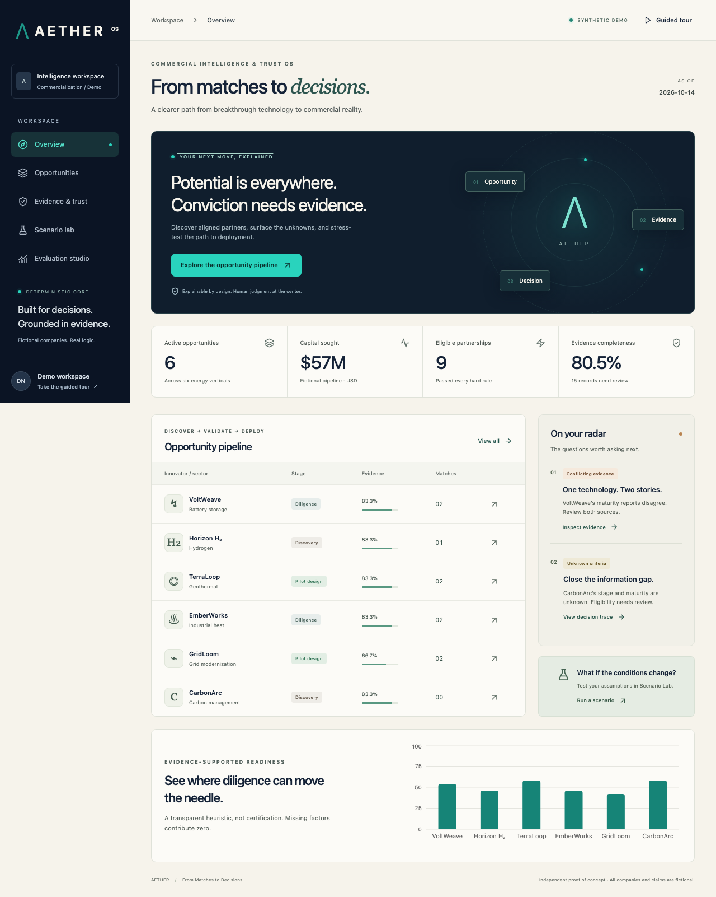

# AETHER — Commercial Intelligence & Trust OS

**From Matches to Decisions.** An independent energy-commercialization proof of concept with explainable matching, evidence provenance, scenario simulation and evaluation. All companies, claims and verification labels are fictional. No competitor architecture or superiority claims are made.



## Run locally

```sh
python3 -m venv .venv
.venv/bin/pip install -r backend/requirements.lock
AS_OF_DATE=2026-10-14 .venv/bin/uvicorn app.main:app --app-dir backend --port 8000
```

In a second terminal:

```sh
cd frontend
npm ci
npm run dev
```

Open http://127.0.0.1:5173. OpenAPI: http://127.0.0.1:8000/docs. No credentials are required for the full deterministic workflow. Python 3.13 and Node 22 are the deployment/CI targets.

## What works

- Six innovators across battery storage, hydrogen, geothermal, industrial heat, grid modernization and carbon management; investor and industrial buyer mandates.
- Derived dashboard metrics and filterable opportunity records; hard eligibility gates, weighted ranking, score components, rejection reasons and unknown-data review.
- Source provenance, verification/observation dates, freshness, missing factors, conservative contradiction detection and an explicit decision trace.
- Six-factor evidence-supported commercialization readiness; non-mutating simulations of funding stage, geography, capital, TRL and buyer constraints.
- A 24-pair labeled evaluation fixture with precision/recall@K, hard-rule violations, evidence/freshness metrics and regression comparisons.
- Optional bounded Cloudflare grounded explanations and operator-run embeddings. Deterministic fallback is transparent. PostgreSQL/pgvector migrations and repeatable seeds are included.
- Responsive React/TypeScript/Vite UI with Tailwind, Lucide, Recharts and Motion; error/loading/empty states and accessible controls.

## Verification

```sh
.venv/bin/python -m pytest -q
.venv/bin/ruff check backend scripts
cd frontend
npm run typecheck
npm run lint
npm test
npm run build
npx playwright install chromium
npm run test:e2e
```

Database integration: export DATABASE_URL, then run `PYTHONPATH=backend .venv/bin/python scripts/database.py` twice and `PYTHONPATH=backend .venv/bin/python scripts/verify_database.py`. The GitHub Actions workflow runs these checks against isolated pgvector PostgreSQL. See [verification report](docs/VERIFICATION.md) for actual executed results and remaining external checks.

## Architecture and operations

`frontend/` contains the browser client; `backend/app/` separates models, deterministic domain functions, repository, AI adapter and HTTP handlers. `supabase/migrations/` contains versioned SQL; `scripts/` contains migration, seed, embedding and verification operations. No model weights run in Python.

- [Architecture](docs/ARCHITECTURE.md) · [Decisions](docs/DECISIONS.md) · [Tradeoffs and 10× growth](docs/TRADEOFFS.md)
- [Evaluation definitions](docs/EVALUATION.md) · [Security boundaries](docs/SECURITY.md)
- [Exact Render, Supabase and Cloudflare setup](docs/DEPLOYMENT.md) · [Three-minute interview demo](docs/INTERVIEW_DEMO.md)

Deployment configuration targets a $0/month modest demo on Render Free + static hosting, Supabase Free and Cloudflare Workers AI Free. No live URL is claimed until deployed and verified. No credentials are included. The public demo is not suitable for confidential records without authentication and tenant authorization.

MIT license, preserved from the original repository.
