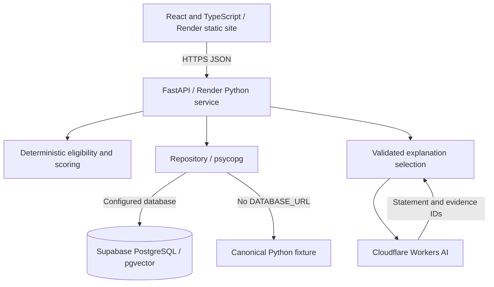

# AETHER

### Commercial Intelligence & Trust OS

**From matches to inspectable decisions.** An independently developed, production-deployed clean-energy commercialization proof of concept. AETHER connects deterministic partner eligibility, weighted ranking, evidence provenance and optional AI explanations in one workspace.

[**Open live application ↗**](https://ai-investor-match-making-engine.onrender.com) · [**Engineering case study ↗**](https://ai-investor-match-making-engine.onrender.com/review) · [Architecture](docs/ARCHITECTURE.md)

> Independent technical proof of concept · All opportunities, partners, evidence and verification labels are synthetic. No real commercial partnerships or investor validation are claimed. The `/review` page is included in this branch and becomes available on the live site after an approved deployment.


## The problem and the approach

A promising technology is not automatically a compatible investment or industrial partnership. Mandates can exclude it; missing information can block a decision; apparently persuasive evidence can be stale, contradictory or unverified.

AETHER makes those distinctions visible. It checks recorded fields against explicit partner requirements, separates hard eligibility from ranking, and exposes the evidence behind the workspace. Scenario Lab explores changes without changing stored records. AI helps select explanations; it never owns the decision.

## Core capabilities

| Capability             | Implemented boundary                                                                                                                                       |
| ---------------------- | ---------------------------------------------------------------------------------------------------------------------------------------------------------- |
| Deterministic matching | Sector, stage, geography, capital, TRL and industrial-buyer integration checks. Known failure wins over unknown; unknown without failure routes to review. |
| Evidence & trust       | Source labels, dates, freshness, missing factors, conservative contradictions and human-review metadata. No independent verification service.              |
| Grounded explanations  | Cloudflare selects approved statement and evidence IDs. Strict validation and deterministic rendering prevent model-authored decision claims.              |
| Scenario Lab           | In-memory copies expose eligibility changes under new assumptions. Original records remain unchanged.                                                      |
| Evaluation             | A fixed synthetic benchmark of 24 labeled pairs. Useful for regression, not evidence of real-market accuracy.                                              |

## Architecture



The repository reads JSONB records and optional vectors. Exact cosine similarity runs in Python; there is no approximate vector retrieval. Matching works without embeddings. A configured database failure returns an error rather than silently substituting fixtures.

## Key engineering decisions

- **Rules before generation.** Python determines eligibility, score and allowed statements. AI cannot promote a rejected pair.
- **Gate and rank separately.** The score is a heuristic index, not a probability. Increasing capital can change eligibility while leaving the score unchanged.
- **Preserve uncertainty.** Same-factor differing values or disputed status flag a conflict. No source is silently declared the winner.
- **Degrade explicitly.** Missing AI credentials, local limits, provider errors and invalid output return deterministic explanations with a visible mode/reason.
- **Keep the operating model small.** Static frontend, one Python worker, external PostgreSQL and optional inference. Scale and isolation require further work.

Read the [engineering decisions and trade-offs](docs/ENGINEERING_DECISIONS.md).

## Stack

React 19 · TypeScript · Vite · CSS/Tailwind · Recharts · Motion · Lucide · FastAPI · Pydantic · psycopg · PostgreSQL/pgvector · Cloudflare Workers AI · Render · Supabase.

## Evidence and AI trust boundaries

Eligibility describes compatibility with recorded fields, not investment approval. Evidence completeness counts represented factors; readiness separately reflects freshness, verification and conflicts. Every verification label is fictional fixture metadata, including records marked “verified.” Citation IDs establish membership in the supplied record set, not truth or causal support.

The AI adapter accepts bounded JSON selections, including unambiguous fenced/prose wrappers, and rejects invalid schemas, duplicate IDs and unknown references. It renders preapproved statements, with no retries. Attempt budgets are process-local and reset on restart; they are not account-wide spend or abuse controls.

## Evaluation and production observations

At the fixed fixture date **14 October 2026**, K=2 returns nine valid pairs, precision/recall 1.0 and zero hard-rule violations. These figures describe the synthetic benchmark only. [Definitions and denominators](docs/EVALUATION.md).

The retained **15 October 2026** Chromium production smoke report observed:

- Six opportunities and four partners; CarbonArc → Northstar rejected at 28.7/100.
- A Cloudflare explanation with HTTP 200, correct citation opening and Escape/focus restoration.
- VoltWeave capital $8M → $25M changing Northstar/Atlas eligibility to rejected, with zero score delta.
- Mobile layout checks and fourteen observed HTTP 200 responses, with no captured console errors or failed requests.

These are dated observations, not uptime, security or performance guarantees. Local unit tests, browser regressions, configured CI and production checks are distinct evidence categories. See the [production-readiness record](docs/PRODUCTION_READINESS.md); older verification notes describe earlier development stages.

Local case-study branch verification on **15 October 2026**: **37 Vitest tests and 42 Playwright tests passed**, including real Chromium desktop/mobile, keyboard, reduced-motion and automated accessibility checks. Typecheck, ESLint, production build and formatting passed. These are local results, not hosted CI or production guarantees.

Case-study captures: [desktop](docs/screenshots/review-desktop.png) · [mobile](docs/screenshots/review-mobile.png).

## Known limitations

This public demo has no authentication, authorization or tenant isolation. All valid database records are publicly returned and labeled synthetic. Do not add confidential customer data. RLS without public policies does not prevent owner-role bypass.

Runtime reads load the full dataset without a query timeout; synchronous database work in the async explanation route can block the worker. There is no connection pool, general API rate limit, demonstrated restore/failover process or representative load test. Additional opportunity IDs can break the fixed evaluation label map. Real ingestion, independent verification and persisted review workflows are not implemented.

## Run locally

Python 3.13 and Node 22 are the deployment/CI targets. No credentials are required for the deterministic fixture workflow; leave `DATABASE_URL` and Cloudflare credentials unset for that mode.

```sh
python3 -m venv .venv
.venv/bin/pip install -r backend/requirements.lock
AS_OF_DATE=2026-10-14 .venv/bin/uvicorn app.main:app --app-dir backend --port 8000
```

In a second terminal:

```sh
cd frontend
npm ci
npm run dev
```

Open [the workspace](http://127.0.0.1:5173), [the case study](http://127.0.0.1:5173/review) or [OpenAPI](http://127.0.0.1:8000/docs). The case study is static editorial content; its examples do not call inference or recalculate live data. Render's existing SPA rewrite supports direct navigation and refresh.

### Verification commands

```sh
.venv/bin/python -m pytest -q
.venv/bin/ruff check backend scripts
cd frontend
npm run typecheck
npm run lint
npm test
npm run build
npx playwright install chromium
npm run test:e2e
```

For an intentionally configured database, export `DATABASE_URL` in your terminal, then run `PYTHONPATH=backend .venv/bin/python scripts/database.py` twice and `PYTHONPATH=backend .venv/bin/python scripts/verify_database.py` from the repository root. Initialization preserves unrelated rows and rejects conflicting canonical payloads. See [database initialization](docs/DATABASE_INITIALIZATION.md) before using an existing database.

[GitHub Actions](.github/workflows/ci.yml) defines backend/frontend checks, isolated PostgreSQL seed verification and Chromium tests. The optional database test matrix requires a separate loopback test-port configuration; it is not implied by a default pytest run.

## Documentation

- [Architecture](docs/ARCHITECTURE.md) — components, rules, persistence and API boundaries
- [Engineering decisions](docs/ENGINEERING_DECISIONS.md) — rationale, alternatives and scaling trade-offs
- [Production readiness](docs/PRODUCTION_READINESS.md) — verified behavior and remaining work
- [Evaluation](docs/EVALUATION.md) — synthetic benchmark methodology
- [Database initialization](docs/DATABASE_INITIALIZATION.md) — safe migration and seeding
- [Deployment guide](docs/DEPLOYMENT.md) — Render, Supabase and Cloudflare setup; its pre-deployment availability statements are historical
- [Interview demo](docs/INTERVIEW_DEMO.md) — guided exploration

## License and independence

[MIT](LICENSE). Independently developed by Shailendra Nagori. This is not an official Energytech Cypher product; no affiliation with Energytech Cypher or Jason Ethier is claimed. All demonstration companies and evidence are fictional.
