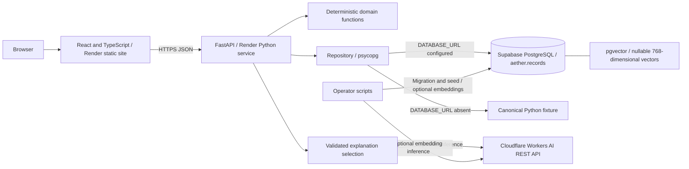
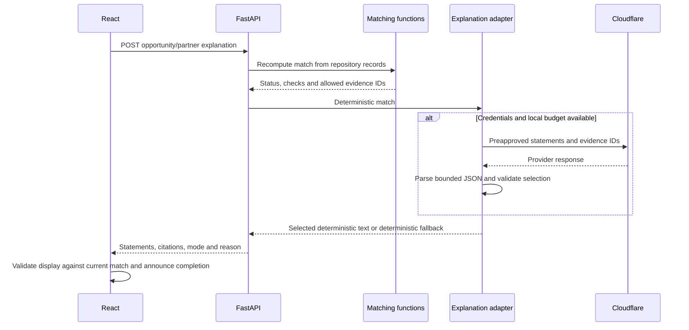

# AETHER architecture

Source baseline: `origin/main` at `4f078a3`, inspected on 15 October 2026. This document describes implemented behavior. See [production readiness](PRODUCTION_READINESS.md) for verification evidence and gaps, and [engineering decisions](ENGINEERING_DECISIONS.md) for trade-offs.

AETHER is a synthetic commercial-intelligence demonstration: six opportunities, four investor/industrial-buyer partners and thirty evidence records. Companies, dossiers and verification labels are fictional. Eligibility is a deterministic comparison of recorded fields; neither a high score nor an AI explanation establishes investment suitability or independently verified evidence.

## Components and deployment

- [App.tsx](../frontend/src/App.tsx) owns navigation, dashboard selection, scenario inputs and asynchronous detail/explanation state. React 19, TypeScript and Vite produce a static bundle. Motion, Recharts and Lucide support presentation; navigation uses component state rather than a routing service.
- [Trust.tsx](../frontend/src/Trust.tsx) renders rule meanings, evidence metadata, citation dialogs and grounded explanation presentation. [api.ts](../frontend/src/api.ts) defines hand-maintained TypeScript contracts and fetch helpers; these are not runtime response validators.
- [main.py](../backend/app/main.py) owns HTTP validation, orchestration and response assembly. [domain.py](../backend/app/domain.py) owns pure matching, evidence and benchmark calculations.
- [repository.py](../backend/app/repository.py) loads Pydantic objects from PostgreSQL, or constructs the [canonical Python fixture](../backend/app/seed.py) when `DATABASE_URL` is absent. A configured database failure does **not** silently switch to fixtures.
- [ai.py](../backend/app/ai.py) optionally selects preapproved explanation statements. It does not decide matches or write records.

[render.yaml](../render.yaml) configures a static frontend and one Python backend worker on a free-plan service. PostgreSQL is external to Render. `VITE_API_URL` is public build-time configuration; `DATABASE_URL` and Cloudflare credentials belong only on the server. The health check uses `/health`, not dependency-aware `/ready`. Actual provider settings, deployment identity, capacity and recovery guarantees cannot be established from this file alone.

## Data path and persistence

Each repository read opens a synchronous psycopg connection with a five-second connection timeout, reads all opportunity and partner payloads, parses optional vector text, and validates domain models. There is no connection pool, application cache or tenant filter. The asynchronous explanation route performs this synchronous read and matching directly on the event loop before awaiting inference, so a slow query can block the single worker. The connection timeout does not bound query execution; runtime reads set no statement timeout. Even the paginated opportunities endpoint loads the full dataset before filtering and slicing in Python.

The [initial migration](../supabase/migrations/20261014161050_aether_initial.sql) stores records in `aether.records`: primary-key ID, constrained kind, JSONB object payload, nullable vector, embedding model and update timestamp. Evidence is nested inside opportunity payloads, not a separate evidence table. The migration discovers the installed vector extension namespace; it uses an existing `public` or `extensions` installation without relocation, or installs it in `extensions` if absent. The vector column has 768 dimensions. There is a kind/ID index, but no approximate vector-search index.

[database.py](../scripts/database.py) applies unrecorded migration filenames and seeds in one transaction, using an advisory lock and lock/statement timeouts. Inserts do nothing on ID conflict, then compare canonical payloads under row locks; a mismatch aborts rather than overwriting data. Unrelated IDs and existing embeddings are preserved. Migration tracking uses filenames, not content checksums. [verify_database.py](../scripts/verify_database.py) checks canonical payloads, evidence, benchmark behavior, RLS and vector compatibility. See [initialization details](DATABASE_INITIALIZATION.md).

[embed.py](../scripts/embed.py) is an optional operator script, not an API or startup task. It sends truncated descriptions/theses to Cloudflare's embedding model and fills up to ten missing vectors per invocation. Matching calculates exact cosine similarity in Python; pgvector supplies storage, not online nearest-neighbor retrieval. Runtime matching does not enforce embedding-model identity, so mixed models require operational prevention.

## Eligibility and ranking

Hard checks compare opportunity fields with each partner mandate:

| Check                | Implemented rule                                                                        |
| -------------------- | --------------------------------------------------------------------------------------- |
| Sector               | Membership in partner sectors                                                           |
| Funding stage        | Membership in partner stages; `Unknown` produces an unknown result                      |
| Geography            | Membership in partner geographies                                                       |
| Capital              | Inclusive partner minimum and maximum, in millions                                      |
| Technology readiness | TRL at least the partner minimum; missing TRL is unknown                                |
| Integration          | Industrial buyers only: complexity at most their maximum; missing complexity is unknown |

Any failed check makes a pair **rejected**, even if another check is unknown. Otherwise any unknown makes it **review**; all passes make it **eligible**. These rules use recorded structured fields, not an inference from evidence text. Conflicts and unverified evidence do not automatically veto eligibility.

Scores are calculated independently, including for rejected pairs:

| Component             | Structured-only weight | Value                                                  |
| --------------------- | ---------------------- | ------------------------------------------------------ |
| Mandate fit           | 40%                    | 100 for sector match, otherwise 0                      |
| Technology maturity   | 25%                    | TRL / 9 × 100; missing contributes 0                   |
| Evidence completeness | 20%                    | Coverage of six canonical factors                      |
| Data freshness        | 15%                    | Percentage of evidence records within freshness window |

When both vectors are usable, equal-length, finite and nonzero, structured weights are multiplied by 0.9 and cosine similarity contributes 10%. Cosine is clamped to [0, 1]. Component contributions round to two decimals; total rounds to one. Scores are heuristics, not probabilities. Verification quality and contradictions affect the separate readiness index, not a direct score penalty.

Ranking orders eligible, review, rejected, then descending score, then partner ID. The evaluation selects only eligible top-K results. Scenario Lab copies opportunity fields and buyer constraints in memory, recomputes baseline and simulated matches, and reports deltas. It persists nothing. A capital change can therefore reject a previously eligible pair without changing its weighted score.

## Evidence and trust

Evidence carries ID, factor, value, source label/type, observed and optional verified dates, verification status, human-review status and confidence text. These are supplied metadata; there is no source-document ingestion or independent verification service.

Freshness uses the verified date if present, otherwise observed date, relative to `AS_OF_DATE` or the server's current date. Ages from 0 through 180 days are fresh; future dates are outside the window. A record is contradictory if explicitly disputed or if its factor has more than one distinct value string. This is a conservative string comparison, not semantic fact checking, and can flag complementary statements.

Readiness gives each of six factors: missing = zero contribution (displayed as missing); any contradiction = 0; otherwise at least one fresh verified record = 100; otherwise = 25. The rounded equal-weight average is an evidence-support index, not certification. Human-review counts include pending or contradictory records; there is no persisted review/approval workflow.

Citation dialogs resolve IDs against the currently loaded opportunity's evidence. Missing IDs get an unavailable state; conflicting same-factor records can be compared. Source metadata, fictional verification labels, freshness and pending review remain visible. AI prose never becomes a source record. Dialogs use native modal behavior, Escape, focus containment/restoration and a single outer scroll area on short viewports. Component keys and effect cleanup prevent results from an unmounted opportunity/partner view appearing in its replacement; loaded snapshots are not automatically refreshed from later database changes.

## Explanation sequence and validation

The default inference model is `@cf/meta/llama-3.1-8b-instruct-fp8`. The request sends preapproved statement strings and evidence IDs, not evidence source text. The provider may select IDs, but cannot supply final claims, scores or eligibility. Mandatory statement 0 carries eligibility and the human-diligence warning. All displayed statement text is rendered on the server from the allowed list; the frontend also checks against the current match.

The parser and subsequent grounding checks together validate the selection. The parser accepts a pure object, a single code-fenced object, or one object surrounded by prose. The parser rejects ambiguous objects, malformed JSON, duplicate keys, invalid types/fields and duplicate IDs. The service then rejects unknown evidence IDs and missing/out-of-range statements. The 8,192-byte limit applies to the model's response string, not the complete downloaded HTTP envelope. There is no `eval`, greedy regex extraction or repair.

Missing configuration, exhausted budget, throttling, provider/parse/validation failures produce a successful deterministic explanation response with mode/reason. Repository failure before matching remains a 503. The adapter uses no retries, a 180-output-token cap and a 12-second HTTP-operation timeout, not a guaranteed total wall-clock deadline. Attempts are limited to one per ten seconds and a configurable maximum of twenty per process per day. Restarts reset counters; multiple processes would multiply them. The frontend has a persistent polite loading/completion status and an error announcement without automatic focus movement.

## API boundaries and failures

| Endpoint                                         | Responsibility                                                                        |
| ------------------------------------------------ | ------------------------------------------------------------------------------------- |
| `GET /health`                                    | Process liveness only                                                                 |
| `GET /ready`                                     | Repository access/counts; AI configuration presence, not provider connectivity        |
| `GET /api/dashboard`                             | Enriched opportunities, partners, aggregate counts, ISO as-of date and synthetic flag |
| `GET /api/opportunities`                         | Optional sector filter and bounded pagination after full read                         |
| `GET /api/opportunities/{id}`                    | Opportunity, ranked matches, trust and readiness                                      |
| `POST /api/opportunities/{id}/scenario`          | Validated, nonpersistent scenario computation                                         |
| `POST /api/opportunities/{id}/explain/{partner}` | Grounded optional AI selection with fallback                                          |
| `GET /api/evaluation`                            | Fixed synthetic benchmark, K from 1 to 4                                              |

The fixed evaluation indexes labels by opportunity ID; an additional valid opportunity with an unknown ID can raise an unhandled error and return 500 rather than a partial benchmark. An invalid `AS_OF_DATE` can similarly fail date-dependent routes while `/ready` still succeeds.

Pydantic validates request/domain types; scenario fields forbid extras. Missing IDs return 404, invalid requests 422, and repository failures a generic 503. The browser fetch helper defaults to a 25-second timeout, exposes errors and supports dashboard retry; the React error boundary provides recovery UI. Backend middleware attaches a request ID and logs method, status and duration. This is basic request logging, not tracing, durable audit or complete exception monitoring.

## Security boundaries and limits

There is no application authentication, authorization or tenant ownership model. The API publicly serves all records loaded from the configured table, with no canonical-ID allowlist or synthetic-data filter. Additional valid records are returned too; invalid payloads can make the entire repository read fail. The dashboard hard-codes `synthetic: true`, and the evidence UI labels every record synthetic, regardless of its actual origin. Preserving unrelated rows during initialization therefore does not isolate them from public reads. Only demonstration data should be stored in this table. CORS restricts permitted browser origins, not direct HTTP clients. Public OpenAPI documentation is enabled. No public endpoint mutates persistent records, but inference requests consume resources.

The migration revokes PUBLIC schema/table privileges and enables RLS without public policies. It does not force RLS: owners and bypass-capable roles can bypass it. These controls do not prove runtime least privilege, deployed Supabase API exposure settings or tenant isolation. Database credentials are server-side, but the current API deliberately returns the dataset publicly. Real confidential customer data requires new authorization boundaries before ingestion.

Static hosting config adds MIME-sniffing, referrer-policy and frame-denial headers; it does not configure a CSP. TLS, secret storage, database grants, backups and provider-level controls depend on deployed infrastructure and were not audited by the browser smoke test. Current architecture favors a small demonstration over availability guarantees, distributed budgets, large datasets or operational recovery automation.
